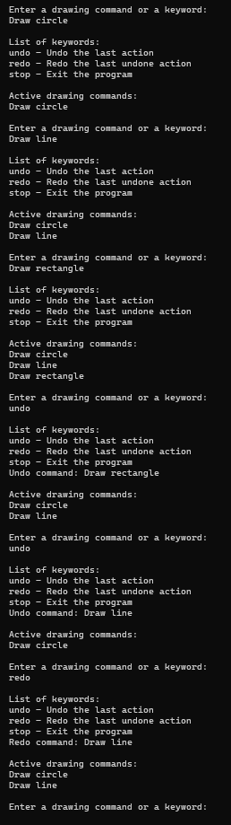
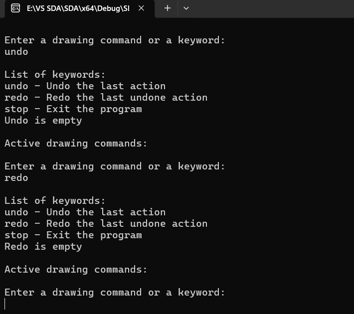
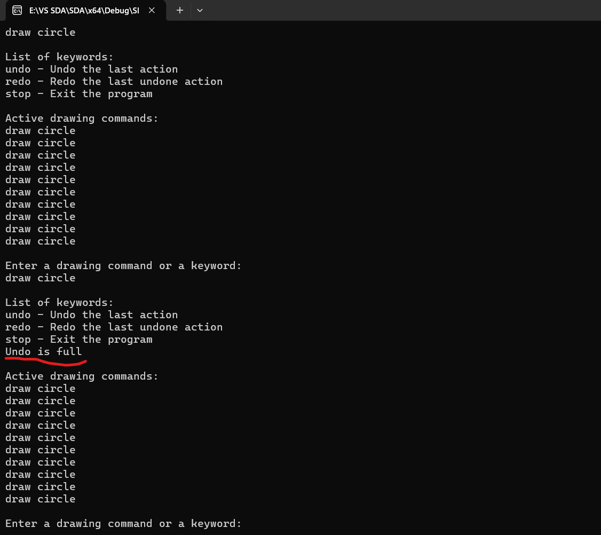

# Структури даних та алгоритми

## Лабораторна робота №3

### Стеки та черги

---

### Виконав

**Студент групи:** ІО-63  
**Котов Роман Дмитрович**  
**Номер у списку групи:** 11

### Перевірив

**Русінов Володимир Володимирович**

---
## Мета лабораторної роботи

Засвоєння теоретичного матеріалу та набуття практичних навичок реалізації й застосування абстрактних структур даних стек (LIFO — «останнім прийшов, першим вийшов») та черга (FIFO — «першим прийшов, першим вийшов»), а також порівняння двох способів їхньої реалізації — на основі масиву фіксованого розміру та на основі однозв'язного списку.
---

## Завдання

Кожен варіант завдання визначає прикладну задачу (наприклад, перевірку збалансованості дужок, обчислення постфіксного виразу тощо) та структуру(и) даних, потрібну для її розв'язання (стек, чергу, або обидві).

### Необхідно розв'язати задачу двома способами:

**1.** на основі одновимірного масиву фіксованого розміру (з окремими змінними/індексами для вершини стека або голови й хвоста черги);

**2.** на основі однозв'язного списку (динамічне виділення пам'яті: вузол зі значенням і вказівником на наступний вузол).

---

---
## Тестування програми 1

## 1

## 2

## 3

---
## Тестування програми 2

## 1

## 2

## 3

---
## Висновок: Під час виконання лабораторної роботи я порівняв реалізацію стеків за допомогою масиву та однозв’язного списку. Масив має фіксований розмір, тому кількість команд обмежена, але він простіший у реалізації та не потребує виділення пам’яті для кожного елемента окремо. Однозв’язний список дозволяє додавати команди динамічно, але для кожного елемента потрібно виділяти додаткову пам’ять під вказівник. В обох реалізаціях операції додавання та видалення елементів виконуються за сталий час O(1). Отже, масив зручний, коли кількість елементів приблизно відома заздалегідь, а список — коли вона може змінюватися під час роботи програми.
