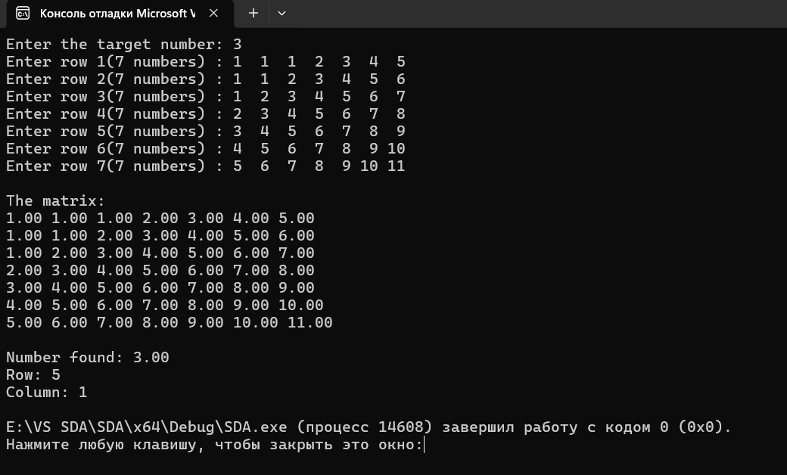
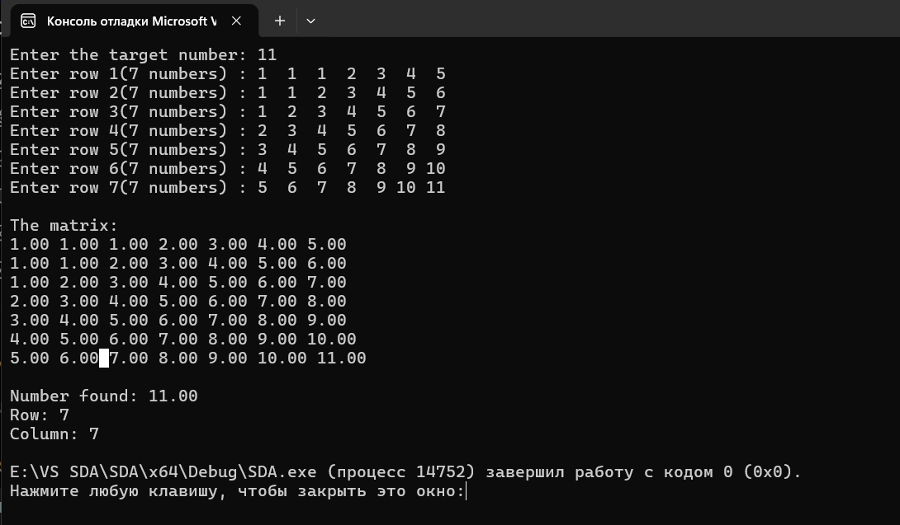
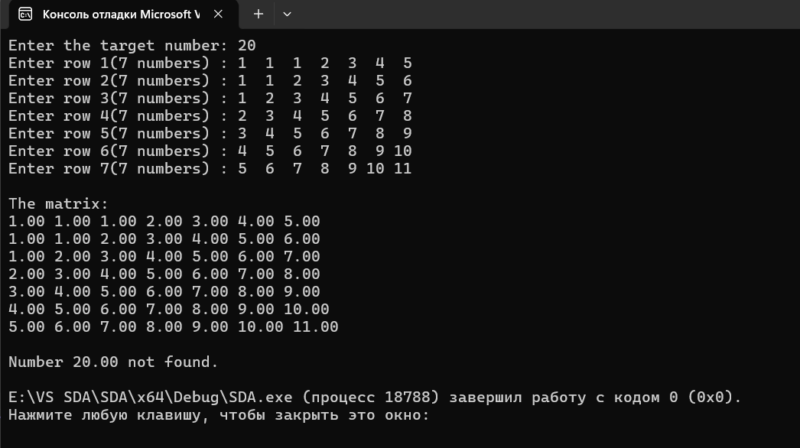

# Структури даних та алгоритми

## Лабораторна робота №4

### Алгоритми двійкового пошуку

---

### Виконав

**Студент групи:** ІО-63  
**Котов Роман Дмитрович**  
**Номер у списку групи:** 11

### Перевірив

**Русінов Володимир Володимирович**

---
## Мета лабораторної роботи

Засвоєння теоретичного матеріалу та набуття практичних навичок розв'язання задачі пошуку заданої категорії елементів за допомогою різних алгоритмів методу двійкового пошуку у двовимірних масивах.
---

## Завдання

Написати програму розв'язання задачі пошуку (за варіантом) у двовимірному масиві (матриці) методом двійкового пошуку. Конкретний алгоритм двійкового пошуку (№1 або №2) задається варіантом завдання.
Розміри матриці m та n взяти самостійно в межах від 7 до 10.
При тестуванні програми підбирати такі вхідні набори значень матриці, щоб можна було легко відстежити коректність виконання пошуку, і щоб ця коректність була протестована для всіх можливих випадків. З метою тестування дозволяється використовувати матриці меншого розміру.

---

---

## Вхідні дані

1.Кількість рядків матриці: (m = 7).
2.Кількість стовпців матриці: (n = 7).
3.Двовимірний масив дійсних чисел (matrix[m][n]), у якому елементи кожного стовпця впорядковані за неспаданням.
4.Дійсне число (target_num), яке необхідно знайти в матриці за допомогою алгоритму бінарного пошуку.
5.Матриця вводиться користувачем з клавіатури. Програма виводить матрицю на екран і визначає позицію шуканого числа, якщо воно присутнє, або повідомляє про його відсутність.

---

## Тестування програми 

## 1

## 2

## 3

## 4

---
## Висновок: У цій лабораторній роботі я реалізував алгоритм бінарного пошуку для знаходження заданого числа в матриці. Під час виконання програми я навчився перевіряти елементи стовпців і визначати координати знайденого числа. Також перевірив роботу алгоритму на випадках, коли число є в матриці та коли воно відсутнє. У результаті закріпив знання про роботу з масивами та використання бінарного пошуку в мові програмування C.
