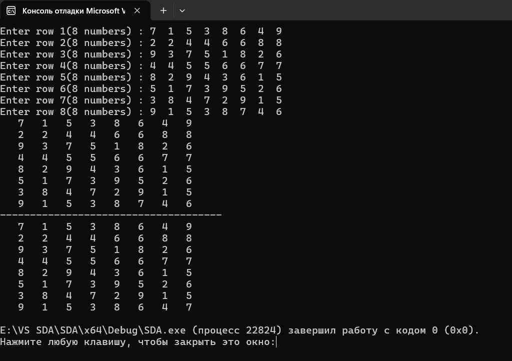
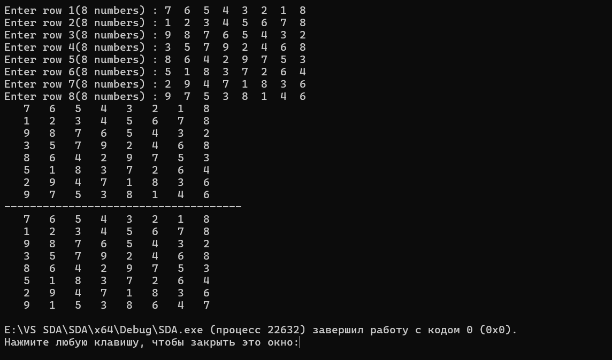
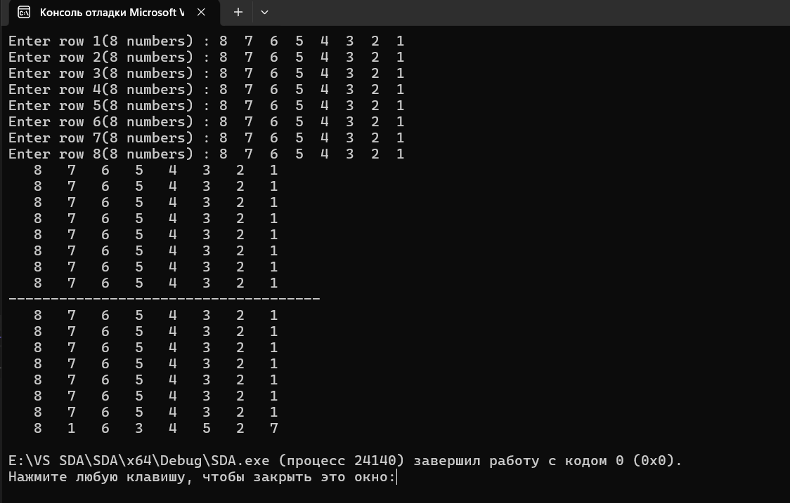
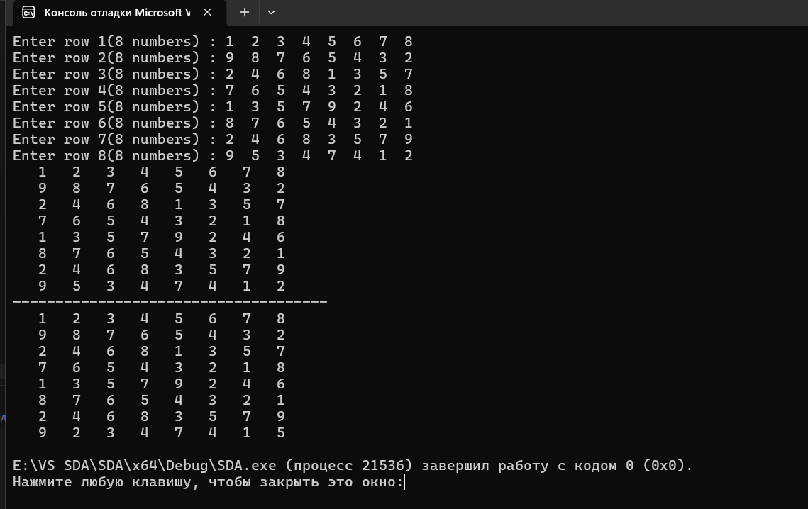

# Структури даних та алгоритми

## Лабораторна робота №5

### Алгоритми сортування

---

### Виконав

**Студент групи:** ІО-63  
**Котов Роман Дмитрович**  
**Номер у списку групи:** 11

### Перевірив

**Русінов Володимир Володимирович**

---
## Мета лабораторної роботи

Засвоєння теоретичного матеріалу та набуття практичних навичок розв'язання задачі сортування заданої категорії елементів за допомогою різних алгоритмів сортування у двовимірних масивах.
---

## Завдання

Задано двовимірний масив (матрицю) цілих чисел A[m,n] або A[n,n], де m та n — натуральні числа (константи), що визначають розміри масиву. Виконати сортування цього масиву або заданої за варіантом його частини у заданому порядку заданим алгоритмом (методом). Сортування повинно виконуватися безпосередньо у двовимірному масиві «на тому ж місці», тобто без перезаписування масиву та/або його частини до інших одно- чи двовимірних масивів, а також без використання спискових структур даних.
Розміри матриці m та n взяти самостійно в межах від 7 до 10.
При тестуванні програми підбирати такі вхідні набори значень матриці, щоб можна було легко відстежити коректність виконання сортування, і щоб ця коректність була протестована для всіх можливих випадків. З метою тестування дозволяється використовувати матриці меншого розміру.

---

---

## Тестування програми 

## 1

## 2

## 3

## 4

---
## Висновок: Висновок: Під час виконання лабораторної роботи № 5 я закріпив знання про алгоритми сортування та набув практичних навичок використання методу вибору мовою програмування C. Було реалізовано сортування елементів останнього рядка двовимірного масиву, що стоять на парних позиціях, за незменшенням. Правильність роботи програми перевірено на трьох випадках: відсортованому, невідсортованому та обернено відсортованому масивах. У результаті я навчився виконувати сортування безпосередньо у двовимірному масиві без використання додаткових масивів.
